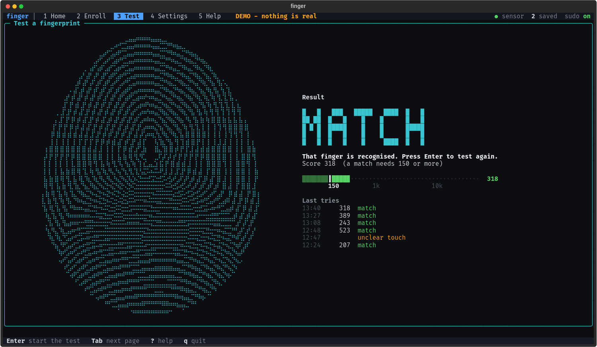

# Goodix 27c6:550c fingerprint reader on Linux

[](https://github.com/fdjfnd222dd/goodix-550c-linux-debian/actions/workflows/tests.yml) [](https://github.com/fdjfnd222dd/goodix-550c-linux-debian/releases/latest) 

**Fingerprint login on Linux for the Lenovo Yoga 9 14IAP7 (Yoga 9i 2022, 82LU).**
Debian 13 packages with a patched libfprint driver, `sudo`/polkit/KDE lock screen support,
and `finger`, a terminal app for enrolling and testing fingers.


## Is this for me?

Yes, if this shows your sensor:

```bash
lsusb | grep 27c6:550c
```

and `fprintd-list` says `No devices available`. Other errors that land here:
`Impossible to enroll: GDBus.Error:net.reactivated.Fprint.Error.NoSuchDevice`,
`USB error on device 27c6:550c: Invalid parameter [-2]`.

| Laptop | Status |
|---|---|
| Yoga 9 14IAP7 (firmware 13021) | ✅ works |
| Yoga 9 14IRP8 (firmware 13022) | ⚠️ untested, testers wanted |

Details: [docs/COMPATIBILITY.md](docs/COMPATIBILITY.md)

## Install

You need the **original Windows install** that paired the sensor, because its key has to be
recovered once. Full guide: [docs/DEBIAN-INSTALL.md](docs/DEBIAN-INSTALL.md).

1. Download both `.deb` files from [Releases](https://github.com/fdjfnd222dd/goodix-550c-linux-debian/releases/latest) and install them.
2. Then:

```bash
sudo apt-mark hold libfprint-2-2
sudo goodix550c-ctl install-psk /path/to/goodix550c.psk
goodix550c-ctl doctor
finger
```

`finger` walks you through enrolling. Turn on fingerprint for `sudo` in its Settings page,
or with `sudo goodix550c-ctl pam enable`.

## The `finger` app

| Enroll | Test |
|---|---|
|  |  |

Pages: Home, Enroll, Test, Settings, Help (keys `1` to `5`, `q` quits).
`finger --demo` runs without a sensor.

## How well it works

About 85% of touches match on the first try, with zero wrong-finger accepts and zero
sensor-start failures in 100+ opens. Method and numbers: [docs/measurements.md](docs/measurements.md).

## Safety

- Unofficial and reverse-engineered. It never writes sensor firmware or keys.
- Your password always keeps working. If the sensor fails, you get the password prompt.
- Only firmware `GF5288_GM168SEC_APP_13021` is accepted. Anything else is refused.
- Stored fingerprints are not encrypted (a libfprint limitation).

Something broke? [docs/RECOVERY.md](docs/RECOVERY.md) has one-line recovery and rollback to stock.

## More

- [docs/RESEARCH.md](docs/RESEARCH.md): the original Ubuntu driver lab, test harnesses, PSK recovery, build from source
- [DOCUMENTATION.md](DOCUMENTATION.md): full engineering record
- [docs/EXPERIMENTS.md](docs/EXPERIMENTS.md): tuning campaign

## Credits

Based on [the-great-king-bart/goodix-550c-linux-driver](https://github.com/the-great-king-bart/goodix-550c-linux-driver)
(MIT, full history kept), which did the original reverse engineering. This repo adds the Debian 13
packages, driver reliability fixes, `goodix550c-ctl` and the `finger` app. MIT licensed.
