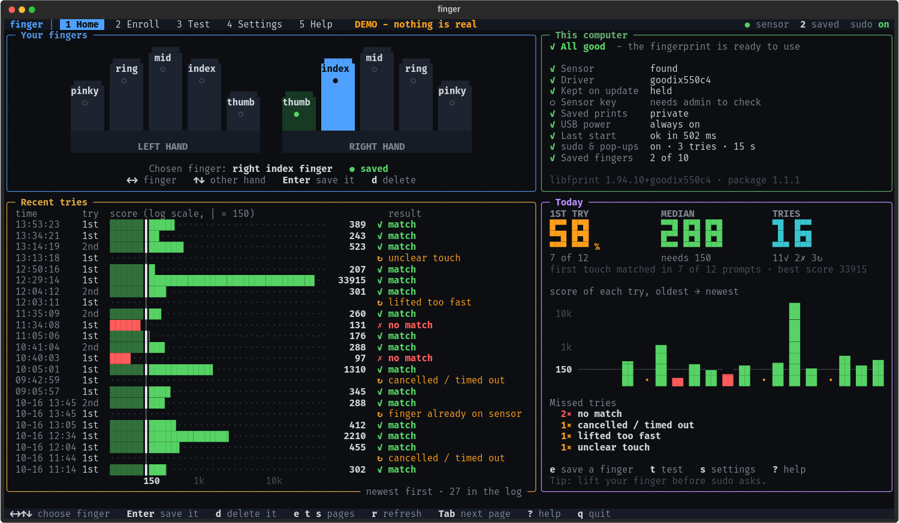
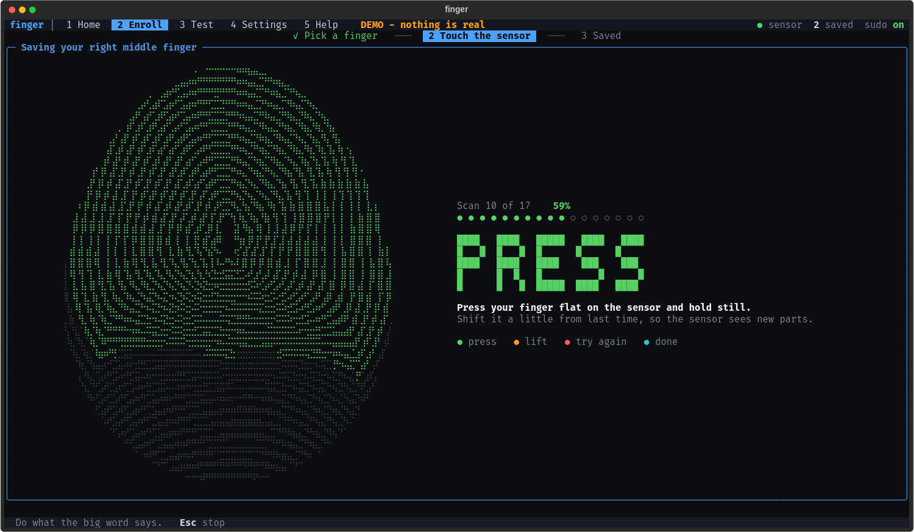

# Goodix 27c6:550c fingerprint reader on Linux — Debian 13 packages + `finger` TUI

**Fingerprint login for the Lenovo Yoga 9 14IAP7 (Yoga 9i 2022, 82LU) on Linux.**
If `lsusb` shows `27c6:550c Shenzhen Goodix Technology Co.,Ltd. FingerPrint` and fprintd says
`No devices available`, this project is for you: a fail-closed libfprint driver, Debian 13
`.deb` packages, fprintd/PAM setup for `sudo`, polkit and the KDE lock screen, and a friendly
terminal app (`finger`) to enroll and test your fingers.



| | |
|---|---|
| **Does my laptop work?** | Run `lsusb \| grep 27c6:550c`, then see [docs/COMPATIBILITY.md](docs/COMPATIBILITY.md). Yoga 9 14IAP7 ✅ · Yoga 9 14IRP8 ⚠️ (firmware 13022, testers wanted) |
| **Install on Debian 13** | [docs/DEBIAN-INSTALL.md](docs/DEBIAN-INSTALL.md) — packages on the [Releases](../../releases) page |
| **Something broke?** | [docs/RECOVERY.md](docs/RECOVERY.md) — one-line recovery and rollback to stock |
| **How well does it work?** | [docs/measurements.md](docs/measurements.md) — ~85% first-touch match, 0 wrong-finger accepts, 0 sensor-start failures in 100+ opens |
| **Important** | Unofficial and reverse-engineered. It never writes sensor firmware or keys. You need the **original Windows install** that paired your sensor to recover its key. Your password always keeps working. |

Searching for an error? These all land here: `list_devices failed: No devices available`,
`Impossible to enroll: GDBus.Error:net.reactivated.Fprint.Error.NoSuchDevice`,
`USB error on device 27c6:550c: Invalid parameter [-2]`.

This repository is based on [the-great-king-bart/goodix-550c-linux-driver](https://github.com/the-great-king-bart/goodix-550c-linux-driver) (MIT; full history kept),
which did the original reverse engineering (Ubuntu TOD module, engineering record below). This repository adds
Debian 13 packaging, driver reliability fixes (patches 0015–0019), the `goodix550c-ctl` tool and the `finger` TUI.

---

## Original project: Goodix 27c6:550c Linux driver lab

The USB fingerprint reader in the Lenovo Yoga 9 14IAP7 enumerates as `27c6:550c`,
and upstream `libfprint` lists it as unsupported: no driver binds to it. This
project makes it work on Ubuntu — enrolment, verification, and fingerprint login —
and documents the evidence for every claim it makes.

It reached a working end state. On Ubuntu 26.04 with `libfprint 1.95.1+tod1`, via
Ubuntu's own `fprintd` and a screen-lock PAM prompt:

```text
Enrollment complete with 16 samples          16 stages in 46s
Identify best SIGFM score: 8903 (best_min: 150)
report_verify_status: result verify-match
```

Non-enrolled fingers, measured over nine clean captures, scored **0 to 10** against
a threshold of **150**, with the weakest accepted genuine attempt at **2247**. The
two distributions do not approach each other. That is a separation measurement, not
a false-accept rate — see [what the numbers do and do not
show](#what-this-does-not-establish).

The interesting engineering problem was not the protocol. It was that this unit's
firmware, `GF5288_GM168SEC_APP_13021`, never emits the asynchronous finger-down
event the driver design assumes, so contact has to be detected by polling raw
capacitance deltas — and that the sensor intermittently returns blank reference
frames for about eleven seconds after being put to sleep, which silently poisoned
every template enrolled during the window.

There are three deliberately separated layers:

- a tightly allow-listed Python identity/backup probe that cannot reset or
  configure the sensor;
- an isolated `libfprint` 1.94.10 build for the exact `550c` that can perform a
  TLS open, enrolment, and verification. Persistent mutation is denied at the
  transport boundary, and volatile initialization needs both a build-time and a
  runtime opt-in;
- a source-recompiled external TOD module for Ubuntu's exact
  `libfprint 1.95.1+tod1` runtime. It leaves Ubuntu's core library and `fprintd`
  untouched and has a private-D-Bus smoke mode in which USB is not visible.

## Debian 13 (trixie)

A separate, packaged path for Debian 13 on amd64 (developed on a Lenovo Yoga 9
14IAP7, kernel 6.12, KDE/SDDM). It does not use the Ubuntu TOD module: trixie has no
TOD-capable libfprint, so it ships a replacement `libfprint-2-2`
(`1:1.94.10+goodix550cN`) built from the same driver patch series.

- **Supported:** sensor `27c6:550c` with firmware `GF5288_GM168SEC_APP_13021` only
  (any other firmware is refused by design). It needs the pre-shared key (PSK) from
  the Windows install that originally paired the sensor; see
  [docs/DEBIAN-INSTALL.md](docs/DEBIAN-INSTALL.md).
- **Two packages:** `libfprint-2-2` (the patched library; it `Provides:
  libfprint-goodix550c`; held and pinned so updates do not replace it) and
  `goodix550c-fingerprint` (fprintd drop-in, udev power rule, TLP denylist, an
  opt-in `pam-auth-update` profile, apt pin, the `goodix550c-ctl` helper and the `finger` TUI). The
  PSK is never in a package.
- **Quick start**, after installing both debs and holding the library
  (`sudo apt-mark hold libfprint-2-2`):

```bash
sudo goodix550c-ctl install-psk /path/to/goodix550c.psk
goodix550c-ctl doctor
goodix550c-ctl enroll right-index-finger
sudo goodix550c-ctl pam enable
```

  `goodix550c-ctl status` shows what is missing and why. The PAM profile applies to
  `sudo` and polkit only; the KDE lock screen keeps using KDE's own
  `kde-fingerprint` service, and the display-manager login is left alone. A missing
  or failing sensor always falls through to the password prompt.
- **`finger` TUI** (package `goodix550c-fingerprint` >= 1.1.0): a full-screen terminal app
  that makes enrolling and testing hard to get wrong. Run `finger` (alias
  `goodix550c-tui`; the package declares `Conflicts: finger` because Debian's unrelated
  `finger` package owns that command name). Pages: `1` Home (a dashboard: both hands with
  the saved fingers, a status checklist with a one-line fix next to anything wrong, every
  logged try with its score on a log-scale bar against the threshold 150 and the result in
  plain words, and today's first-try match rate, median score and missed-try reasons from
  the driver's journal lines), `2` Enroll (pick a finger on the hands, then a big
  fingerprint fills up ridge by ridge, one step per accepted scan: green PRESS, orange LIFT,
  red TRY AGAIN, cyan DONE), `3` Test (MATCH / NO MATCH with the score), `4` Settings
  (tries 1-5, sudo timeout 5-30 s, fingerprint for sudo/polkit on or off, and a picture of
  what sudo will do), `5` Help. Keys: arrows or `h j k l`, Enter, Esc, `e`/`t`/`s` jump to
  Enroll/Test/Settings, `d` delete, `?` help, `q` quit. Settings that need root show the
  exact `sudo goodix550c-ctl pam set ...` line first and run it in your normal terminal,
  so sudo asks for the password there. `finger --demo` runs on made-up data without the
  sensor. It needs `python3-textual (>= 2.1)` and `python3-rich`; it was tested on
  textual 2.1.2 / rich 13.9.4 (Debian 13). Source: `tui/goodix550c_tui/`; tests:
  `build/tui-venv/bin/python -m pytest tests/tui`; screenshots (demo data, 160x45):
  `docs/img/finger-{home,enroll,test,settings}.png` (+ `.svg`);
  `scripts/make_tui_screenshots.py --png` regenerates them (`--all` renders every state at
  120x35 and 200x50). The command-line equivalent of the
  settings page is `sudo goodix550c-ctl pam set --tries N --timeout S` (saved in
  `/etc/goodix550c/pam.conf`, kept across package upgrades); `goodix550c-ctl status --json`
  is what the TUI reads.




- **When something breaks** (Timeshift restore, update, bad PAM change): see
  [docs/RECOVERY.md](docs/RECOVERY.md). Measurement method and results:
  [docs/measurements.md](docs/measurements.md). Design rationale:
  [DOCUMENTATION.md](DOCUMENTATION.md#debian-reliability-work-2026-10-17).

This path supersedes the author's earlier hand-made home-directory scripts
(`~/*.sh` for installing, re-packaging and enrolling), hand-edited
`/etc/pam.d/common-auth` and `/etc/pam.d/kde`, local fprintd drop-ins and the sleep
hook. `goodix550c-ctl` and the packages replace them; installing
`goodix550c-fingerprint` moves any leftover legacy files to
`/var/backups/goodix550c-legacy/`.

The "Status and safety" notes below describe the Ubuntu research run, which was
removed afterwards. The Debian path is meant to stay installed, and carries the
same research-grade caveats.

## Status and safety

**Nothing here is installed or running on the author's machine.** The driver was
installed, validated against the host `fprintd`, used for real screen unlocks, then
fully removed; the enrolled templates were erased and the crash dumps that had held
decoded frames and the sensor key in memory were shredded. `--uninstall` reverses
every system change this project can make.

**This is research-grade, not production-grade.** It is thirteen patches on an
unreviewed experimental driver fork, validated by one person, on one machine, with
one finger set. The matching separation is good. The code maturity is not. Read
[DOCUMENTATION.md](DOCUMENTATION.md) before trusting it with anything.

**Stored fingerprints are not encrypted.** That is a `libfprint` property, not a
choice made here, and the engineering record documents exactly what protects them
and what does not.

## Set up

```bash
python3 -m venv .venv
.venv/bin/pip install -e '.[dev,reverse,dpapi]'
.venv/bin/pytest
```

Fetch and verify the exact public source revisions used by both native builds:

```bash
scripts/fetch_upstream_sources.sh
```

That command initializes only ignored directories below `research/upstream/` and
performs depth-one fetches of these immutable revisions:

| Source | Public URL | Revision |
|---|---|---|
| Goodix 550c driver | `https://github.com/brianporeilly/goodix-550c-driver.git` | `a3de5a1b6174ace5db0bb2a8796c5be6e55428f0` |
| libfprint | `https://gitlab.freedesktop.org/libfprint/libfprint.git` | tag `v1.94.10`, commit `0c97a47d8ef405cd577b87058c1e89cae9d242e7` |

Use `scripts/fetch_upstream_sources.sh --offline` to verify cached clones without
network access. Build scripts refuse missing inputs and point back to this command;
they also independently verify the pinned commits before archiving any source.

The native driver build additionally needs Meson/Ninja, GLib/GIO, GUsb, OpenSSL,
and the OpenCV core/features2d/flann/imgproc development components. On this host:

```bash
scripts/build_goodix550c_libfprint.sh \
  --allow-volatile-init \
  --allow-manual-fdt-poll \
  --stage-dir build/goodix550c-13021-manual-fdt-v7
```

The build stays below `build/`; it neither installs nor runs the driver. Its
minimal exact-device harness is emitted as
`build/goodix550c-13021-manual-fdt-v7/builddir/goodix550c-open-close`.
Before emitting that harness, the build runs offline native regressions for the
paired TLS channel and for the patched production FDT-down command path. The latter
compiles the actual Goodix command and protocol encoder sources, replaces only USB
submission with an in-memory capture, and checks the complete firmware-13021 wire
frame.

After confirming fprintd is inactive and no process/driver owns the USB interface,
the guarded live open can be repeated with:

```bash
sudo chown root:root research/secrets/goodix550c.psk
sudo scripts/run_goodix550c_open_close.sh \
  --stage-dir build/goodix550c-13021-manual-fdt-v7 \
  --psk-file research/secrets/goodix550c.psk \
  --allow-volatile-init
sudo chown "$USER:$USER" research/secrets/goodix550c.psk
```

`--allow-volatile-init` is required for each run; the volatile USB/MCU reset gate
is never enabled without that explicit acknowledgement. `--allow-manual-fdt-poll`
is accepted but optional here, because this harness only opens and closes and
reaches no manual-FDT state; pass it only to reproduce the exact live environment,
and omit it for a control run against a manual-FDT stage. The runtime gate
`GOODIX550C_ALLOW_MANUAL_FDT_POLL=1` is exported only when the flag is given, and
any inherited value is cleared. The wrapper stops nothing: any holder, bound
interface driver, or active fprintd causes refusal.

This isolated 1.94.10 path exists to validate the driver against a build-tree
library. For a live open against Ubuntu's *installed* runtime, prefer the guarded
TOD open/close under "Guarded physical TOD open/close" below: that wrapper adds
build-metadata, module/harness digest, source-drift, package-version, and exact
endpoint checks that this isolated wrapper does not perform.

The manual fallback is firmware-13021-specific and requires both the compile-time
option above and runtime value `GOODIX550C_ALLOW_MANUAL_FDT_POLL=1`, which the
guarded wrapper supplies only after the explicit flag. Keep the pad fully clear
during open and the pre/post-reference baseline phases, and do not suspend the
machine during the experiment. Manual responses are classified only from two
consecutive raw 24-byte readings; the device's touch flag is ignored because it
was observed nonzero with hands clear. No raw readings or per-channel metrics are
logged or persisted.

Neither reference-baseline phase waits forever: each fails the action after 100
polls (10 s), and the finger-up wait fails after 600 polls (60 s), so a pad that
never settles ends in an error instead of an endless USB poll. Only the
finger-down wait is deliberately unbounded, matching the asynchronous path it
replaces; it ends on cancellation. If the machine is suspended while a poll owns
the device, the driver now refuses the suspend rather than reporting one it cannot
honor, and the in-flight action fails at its next cancellation check.

## Ubuntu 26.04 TOD module without USB access

The preferred integration artifact is `libgoodix550c.so`, an external TOD driver
for the installed `fprintd 1.94.5-4` and
`libfprint 1:1.95.1+tod1-0ubuntu2`. The build refuses a different architecture or
runtime package version. It recompiles the exact fail-closed source allowlist
against verified Ubuntu headers; it does not reuse 1.94.10 object files or replace
the installed core library.

Fetch and verify the two pinned public development packages, then build with the
volatile path compiled out:

```bash
scripts/fetch_ubuntu_tod_sdk.sh
scripts/build_goodix550c_tod_module.sh \
  --offline-sdk \
  --stage-dir build/goodix550c-tod-default-off
```

The package digests are pinned in the fetcher. All downloads, extracted headers,
patched sources, binaries, and metadata remain below `build/`. The build runs a
source-policy audit, an exact core/TOD ABI audit, and the offline paired TLS test.
It never installs the module or invokes fprintd.

The loader and D-Bus integration can be tested without exposing the host's USB
devices:

```bash
scripts/smoke_goodix550c_tod_fprintd.sh \
  --module build/goodix550c-tod-default-off/builddir/libgoodix550c.so \
  --run-dir build/goodix550c-tod-smoke
```

This starts only a directly executed fprintd and a non-activating private bus, both
as recorded child processes. Bubblewrap supplies a fresh `/dev`, empty `/sys`,
`/run`, and `/tmp`, a read-only host root, and an empty overlay at the checkout
path. Only the dedicated smoke run directory is rebound at
`/run/goodix550c-tod-smoke`; assertions prove `.env` and `research/secrets` are not
visible. The environment is rebuilt from empty, so no PSK is inherited. Cleanup
checks shell-job ownership plus `/proc` parent, start-time, and executable identity
before it signals either recorded child; no system service is queried, stopped, or
restarted.

Two independent hardened default-off builds produced identical module SHA-256
`d2c473c98b47bae29fceed2532002d8cccbd6d8911a495de8dc1b293401abd5a`
and identical installed-runtime harness SHA-256
`bf0f4e6d079f636a77182f1ad4140ff0b77a93d4b5ddf93537dc6176071dfc66`.
This module digest reflects the full `driver-series` including patch `0005`,
whose manual-FDT source is present but compile-gated off in a default-off build.
The no-USB smoke loaded driver ID `goodix53x5` through the installed TOD loader and
returned an empty device array, as required. This validates loading and D-Bus
plumbing only; installation and physical-device testing remain separate,
explicitly authorized phases.

## Guarded physical TOD open/close

Build a separate module with volatile initialization compiled in. This still
installs and runs nothing:

```bash
scripts/build_goodix550c_tod_module.sh \
  --offline-sdk \
  --allow-volatile-init \
  --allow-manual-fdt-poll \
  --stage-dir build/goodix550c-tod-manual-fdt-v3
```

The build also emits `goodix550c-tod-open-close`, a PIE linked directly to the
installed Ubuntu core and TOD SONAMEs without an RPATH. The physical wrapper
requires a fresh command-line opt-in, verifies module, harness, and project-relative
tracked-input manifests, reruns the source/ABI audit, compares the decoded PSK to
the independent live hash oracle without printing either, and checks the exact USB
interface and endpoints.
It refuses an active fprintd, a bound interface, or any process holding the USB
node; it never stops any of them.

```bash
sudo chown root:root research/secrets/goodix550c.psk
sudo scripts/run_goodix550c_tod_open_close.sh \
  --stage-dir build/goodix550c-tod-manual-fdt-v3 \
  --psk-file research/secrets/goodix550c.psk \
  --expected-psk-hash research/artifacts/psk-hash-current.json \
  --allow-volatile-init
sudo chown "$USER:$USER" research/secrets/goodix550c.psk
```

This run needs no finger: the harness opens the device and closes it, and reaches
no manual-FDT state. Keep the pad clear for the whole run.

As with the isolated wrapper, `--allow-manual-fdt-poll` is accepted but optional
and changes nothing an open/close can reach; the runtime gate is exported only when
it is given. Only the project-local module is exposed to the installed TOD loader.
The initial USB reset remains behind the volatile opt-in; after that reset and
firmware read, the driver requires `GF5288_GM168SEC_APP_13021` before MCU reset,
register writes, or configuration upload. A successful PSK-TLS handshake is required
before open can pass. The wrapper uses project-local HOME/TMP/XDG directories, a
rebuilt environment, and a 45-second bound; it performs no installation or
persistent sensor command. Its per-run private directory under `build/` is removed
on every exit path.

## Guarded enrollment capture test

This is the only command that reads a finger. It runs `fp_device_enroll_sync`
through the same guarded wrapper and **discards the template**: nothing is stored,
printed, or hashed. It is a capture test, not a way to register a fingerprint.

```bash
sudo scripts/run_goodix550c_tod_open_close.sh \
  --stage-dir build/goodix550c-tod-capture-diag \
  --psk-file research/secrets/goodix550c.psk \
  --expected-psk-hash research/artifacts/psk-hash-current.json \
  --allow-volatile-init \
  --allow-manual-fdt-poll \
  --enroll --debug
```

`--enroll` requires `--allow-manual-fdt-poll`. `--debug` adds driver diagnostics; it
logs no key, raw reading, image, or template. The run is bounded at 240 seconds.

Operating it, in order:

1. Keep the pad **completely clear** until the harness prints
   `>>> PLACE your finger on the sensor now`. Before that it establishes two
   no-finger reference baselines, and contact corrupts them.
2. Rest your finger on the sensor. No need to press hard — the driver waits
   `GOODIX_MANUAL_FDT_DOWN_SETTLE_MS` (300 ms) for the contact to settle before it
   reads the pad.
3. Lift as soon as it prints `>>> LIFT your finger off the sensor.` The finger-up
   wait is bounded at 600 polls (60 s); holding past that fails the enrollment.
4. Repeat for all 8 stages.

Watch the harness output directly. Its prompts fire at the moment the operator must
act, so anything that relays them second-hand adds latency against that 60 s bound.

Current state: **a full 8-stage enrollment passes**, zero rejections, every frame at
0.0% non-contact. If a stage is ever rejected with "the finger was not centered
properly", that is the coverage gate reporting real partial contact — do not work
around it by loosening `GOODIX_ENROLL_MAX_CLIPPED_FRACTION`, which would enroll
unusable templates and raise false-accept risk. See DOCUMENTATION.md for the
measurements.

## Guarded verification test

Same wrapper, `--verify` instead of `--enroll`. It enrolls, keeps the template
**in process memory only**, then matches live fingers against it. Neither the
template nor any scanned print is stored, printed, or hashed.

```bash
sudo scripts/run_goodix550c_tod_open_close.sh \
  --stage-dir build/goodix550c-tod-wake \
  --psk-file research/secrets/goodix550c.psk \
  --expected-psk-hash research/artifacts/psk-hash-current.json \
  --allow-volatile-init \
  --allow-manual-fdt-poll \
  --verify --debug
```

Eight enrollment placements, then three match trials: two with the enrolled finger
and one with a **different** finger, because a positive-only test would pass against
a driver that matched everything. Bounded at 420 seconds.

Current state: the **first** verification of a session matches correctly. Every later
one in the same session fails because the device stops answering image requests — an
all-zero reference frame and a 95.2% railed capture. The rejection trial has not yet
returned a verdict, so nothing is claimed about false accepts. See DOCUMENTATION.md.

## Fingerprint app (private fprintd)

The harnesses above are capture tests that discard everything. This is the real
thing: the installed fprintd, running on a private non-activating D-Bus with only
the project-local TOD module loaded, driven by fprintd's own client tools.

```bash
sudo scripts/goodix550c_fprintd_app.sh \
  --stage-dir build/goodix550c-tod-cover \
  --psk-file research/secrets/goodix550c.psk \
  --allow-volatile-init --allow-manual-fdt-poll \
  --enroll --finger right-index-finger
```

Swap `--enroll` for `--verify`, `--list` or `--delete`. Prompts come from fprintd
and appear directly in your terminal, so run it yourself rather than through an
assistant relay — the finger-up wait is bounded and relayed cues arrive too late.

`--gui` opens a dark-themed window instead, with the finger picker, a progress bar
and Enrol/Verify/Stop/Delete buttons. "Verify against any enrolled finger" is on by
default, which is what a login gate does; with it off, verification loads only the
named slot. That distinction matters if you store extra passes of one finger under
spare slots to improve coverage, because a named verify would never look at them. That is the only mode whose prompts are
visible when somebody other than the operator starts the session, because a
terminal program can only prompt in a terminal its own operator is attached to.
The window runs as the desktop user while the daemon runs as root for USB, so the
session bus permits both uids. Its socket is owned by the desktop user with the
group set to root and mode 0660, inside a 0710 directory, so exactly those two
accounts reach it and no other does. It is per-run, non-activating, and carries no
secret, since the PSK reaches the driver by file and environment rather than over
the bus.

**This stores fingerprints**, unlike everything else in the project. Templates live
in `build/goodix550c-fprintd-state/prints`, which is git-ignored; delete that
directory to remove every template. The host `fprintd.service` is never started,
stopped, or contacted, nothing is installed system-wide, and the driver's
fail-closed policy is unchanged.

fprintd asks PolicyKit before every device method, and a private bus has no polkit
on it, so `scripts/goodix550c_private_polkit.py` answers on that socket alone. It
authorizes `net.reactivated.fprint.*` and refuses everything else.

## Offline packet preview

This produces the exact bytes without opening the USB device:

```bash
.venv/bin/goodix550c packets
```

## Offline recovery of the existing Windows PSK

The recovery utility performs no USB I/O. It reads the captured 324-byte slot
`0xbb010002` DPAPI blob and the matching offline Windows DPAPI hives/master keys,
then requires the plaintext's SHA-256 to match the separately captured live hash
oracle from slot `0xbb020001`. It never prints the PSK.

The Windows source must be exposed through a repository-local read-only mount. That
bind is currently not mounted; do not run recovery until it has deliberately been
re-established read-only. Check the mount and machine-key prerequisites first:

```bash
findmnt .dpapi-windows-ro
.venv/bin/python scripts/recover_windows_dpapi_psk.py --preflight
```

Verify and discard the plaintext immediately:

```bash
.venv/bin/python scripts/recover_windows_dpapi_psk.py
```

Or explicitly create a driver-compatible hex key, mode `0600`, under the ignored
secret directory:

```bash
.venv/bin/python scripts/recover_windows_dpapi_psk.py \
  --blob research/secrets/psk-dpapi.bin \
  --expected-hash research/artifacts/psk-hash.json \
  --output research/secrets/goodix550c.psk
```

The utility refuses a writable Windows source, output outside `research/secrets`,
existing output files, malformed or wrong-slot E4 data, DPAPI integrity failure, and
any mismatch with the live sensor hash. Its Impacket registry adapter opens the
SYSTEM and SECURITY hives with `rb`, not Impacket's default `r+b` mode.

On this machine the independent recovery run passed both DPAPI integrity and the live
hash-oracle check. The resulting `research/secrets/goodix550c.psk` is ignored by Git,
65 bytes of driver-compatible lowercase hex plus newline, and mode `0600`. Its
contents must never be printed, logged, or committed.

## Live, read-only identity probe

The probe sends only a protocol NOP and a firmware-version request. USB access normally requires root until a dedicated udev rule exists:

```bash
sudo .venv/bin/goodix550c probe \
  --i-understand-this-sends-two-read-only-requests \
  --output research/artifacts/live-probe.json
```

Do not run any upstream `goodix-fp-dump` driver script against this sensor. It does not support PID `550c`, and several scripts intentionally erase and replace firmware.

## Proven live path

The recovered Windows PSK completes a real TLS handshake with firmware
`GF5288_GM168SEC_APP_13021`. Volatile initialization and close both succeed on the
isolated build, and the same open/close passes through Ubuntu's *installed*
`libfprint 1.95.1+tod1` runtime via the TOD module.

Beyond that, through Ubuntu's own `fprintd` with no sandbox: a 16-stage enrolment
completed in 46s, verification returned `verify-match` at a score of 8903, and the
KDE lock screen authenticated by fingerprint. No firmware, PSK, or production data
was ever written to the sensor, and Ubuntu's own `libfprint` and `fprintd` binaries
were never modified — the driver ships as an external TOD module beside them.

### What this does not establish

The false-accept **rate**. Nine non-enrolled presentations with zero false accepts
bounds the rate near 30% by the rule of three, which is no useful bound; a claim
under 1% needs several hundred presentations. The evidence here is the *shape* of
the separation — non-enrolled fingers sit at the noise floor rather than near the
threshold — and it is strong on that axis and weak on sample count.

Those presentations were also the same person's other fingers rather than another
person's. For this sensor that is a harder case in the ways that matter — same
skin, same moisture, same placement habits — but it is not cross-subject data.

The blank-reference fault is absorbed and routed around, not explained. Its cause
is still unknown.

If an open ever fails with `error:1C800066:Provider routines::cipher operation
failed`, the sensor is holding a stale TLS session rather than rejecting the key.
Run the read-only probe once and retry:

```bash
sudo .venv/bin/goodix550c identify psk-hash \
  --i-understand-this-sends-two-read-only-requests
```

See the engineering record for the exact safety gates and private
enrollment/verification procedure.

See [DOCUMENTATION.md](DOCUMENTATION.md) for the evidence, protocol notes, safety model, and current status.
